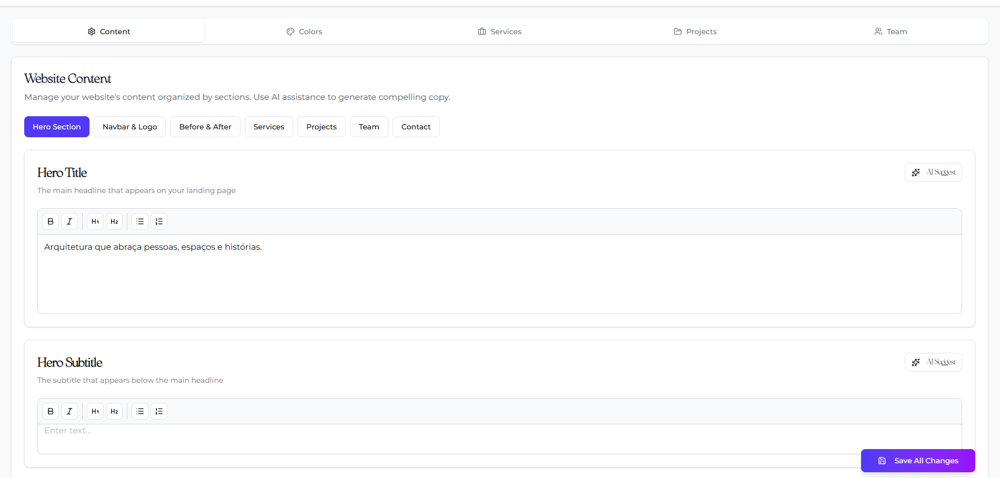
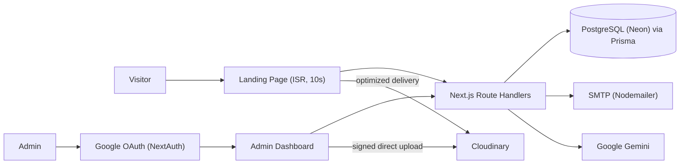

# 🏛️ Gato Arquitetura — Architecture Studio Landing Page & Headless CMS

A full-stack, self-managed website for architecture firms: a cinematic public landing page backed by a private admin dashboard where the studio edits **every text, color, project, service, and team member** without touching code.

Built with **Next.js 16 (App Router)**, **PostgreSQL + Prisma**, **Google OAuth**, **Cloudinary** image delivery, and optional **Gemini AI** copywriting assistance.

🌐 **Live:** [gatoarq.vercel.app](https://gatoarq.vercel.app)

---

## 📸 See It Working

### 1. 🖼️ Public Landing Page

A minimalist, animation-rich single page designed to showcase architectural work and convert visitors into leads.

```
┌─────────────────────────────────────────────────────────────┐
│  🏠 Landing Page Flow                                        │
├─────────────────────────────────────────────────────────────┤
│  🎬 Hero         Parallax background + headline + CTAs       │
│  ↔️ Before/After Drag slider comparing renovation results    │
│  🧰 Services     Cards → modal with detailed description     │
│  🏗️ Projects     Draggable gallery → /project/[id] page      │
│  👥 Team         Member cards with social links              │
│  ✉️ Contact      Lead form → database + email notification   │
└─────────────────────────────────────────────────────────────┘
```

>
> 

### 2. 💻 Admin Dashboard (Headless CMS)

A protected `/admin` panel, accessible only to users flagged as admin in the database, organized into five tabs:

| Tab | What you can manage |
|---|---|
| 📝 **Content** | Hero, navbar logo, Before/After, section titles, contact info |
| 🎨 **Colors** | Primary, secondary, accent, alternative & gradient colors (live theme) |
| 🧰 **Services** | Title, rich-text description, Lucide icon / custom SVG / image icon |
| 🏗️ **Projects** | Cover image, gallery images, rich-text body, category, order, featured |
| 👥 **Team** | Photo, role, LinkedIn, Instagram, email, order |

>
> 

#### ✨ Key Dashboard Features
- **One-Click Image Upload:** Upload straight from the browser to Cloudinary. No URLs to copy, no server body-size limits.
- **Rich-Text Editing:** Slate-based editor for project and service descriptions.
- **AI Copy Assistant:** Generate titles, subtitles, and descriptions with Google Gemini (optional).
- **Instant Publishing:** Saves trigger on-demand revalidation, so changes go live within seconds.

### 3. ⚡ Optimized Image Delivery (Cloudinary)

Every image is served through an automatic optimization layer:

- **Auto format & quality:** `f_auto,q_auto` serves WebP/AVIF at the best compression for each browser.
- **Right-sized per component:** thumbnails (160px), team (320px), cards (800px), gallery (900px), hero/lightbox (1920px).
- **Retina-aware:** `dpr_auto` with smart cropping (`g_auto`) for fixed-ratio images.
- **Lazy loading:** below-the-fold images load lazily; the hero is loaded eagerly with `fetchPriority="high"`.
- **Backward compatible:** non-Cloudinary URLs (e.g., Unsplash) pass through untouched.

### 4. ✉️ Lead Capture & Email Notifications

The contact form stores each lead in PostgreSQL and emails the studio (SMTP via Nodemailer), with `Reply-To` set to the visitor for one-click responses.

---

## 🏛️ System Architecture



---

## 🛡️ Production & Security Engineering

- **Server-Side Authorization:** Every mutating endpoint checks admin status against the database on each request. A stale or forged session can't escalate privileges.
- **Signed Uploads:** Cloudinary signatures are issued only to admins, scoped to a fixed folder and an image-format allowlist. The API secret never leaves the server.
- **Mass-Assignment Protection:** Create/update handlers write only explicitly allowlisted fields.
- **Anti-Spam Contact Form:** Hidden honeypot fields plus per-IP rate limiting (5 submissions / 10 min).
- **Injection Hardening:** Strict input validation and length limits, HTML escaping in email bodies, and CRLF stripping to prevent SMTP header injection.
- **Secrets Hygiene:** All credentials live in environment variables; `.env*` is git-ignored and only placeholder values are committed.

---

## 🧰 Tech Stack

| Layer | Technology |
|---|---|
| Framework | Next.js 16 (App Router), React 19, TypeScript |
| Styling | Tailwind CSS 4, shadcn/ui, Radix UI, Framer Motion |
| Database | PostgreSQL (Neon) + Prisma ORM |
| Auth | NextAuth.js v4 (Google OAuth, JWT sessions, Prisma adapter) |
| Media | Cloudinary (signed uploads + on-the-fly transformations) |
| Email | Nodemailer (SMTP) |
| AI | Google Gemini (`@google/generative-ai`) |
| Hosting | Vercel |

---

## 🚀 Quick Start

### Prerequisites
- Node.js 20+
- PostgreSQL database (e.g., [Neon.tech](https://neon.tech/))
- Google Cloud OAuth credentials
- [Cloudinary](https://cloudinary.com/) account (free tier works)
- SMTP account (e.g., Gmail App Password). Optional.
- Gemini API key. Optional.

### 1. Clone & Install
```bash
git clone https://github.com/MarloFC/ArchProj.git
cd ArchProj
npm install
```

### 2. Environment Variables
```bash
cp .env.example .env
```
Fill in your database, Google OAuth, Cloudinary, SMTP, and Gemini keys.

### 3. Database Setup
```bash
npx prisma generate
npx prisma db push
```

### 4. Run Locally
```bash
npm run dev
```
Open http://localhost:3000. Sign in at `/auth/signin`, then promote your user to admin (see the technical guide) to unlock `/admin`.

---

## 📖 Extended Documentation

For the full architecture, data model, API reference, deployment, and troubleshooting guides, see:
👉 [Technical & Developer Setup Guide](docs/TECHNICAL_SETUP.md)

---

Built with ❤️ for my love.
