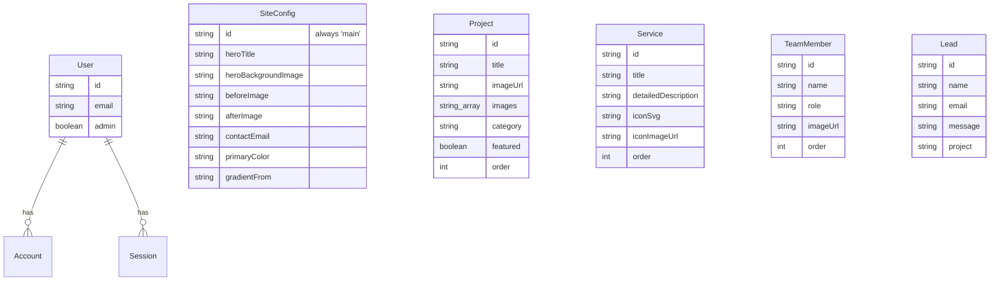
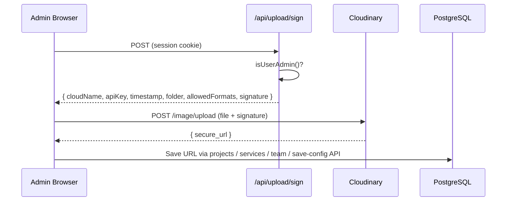

# 🛠️ Technical & Developer Setup Guide

In-depth reference for developers working on **Gato Arquitetura**: architecture, data model, API, configuration, deployment, and troubleshooting.

← Back to [README](../README.md)

---

## 📑 Table of Contents
1. [Project Structure](#-project-structure)
2. [Environment Variables](#-environment-variables)
3. [Database & Data Model](#-database--data-model)
4. [Authentication & Admin Access](#-authentication--admin-access)
5. [API Reference](#-api-reference)
6. [Image Pipeline (Cloudinary)](#-image-pipeline-cloudinary)
7. [Content Rendering & Caching](#-content-rendering--caching)
8. [Contact Form & Email](#-contact-form--email)
9. [AI Content Generation (Gemini)](#-ai-content-generation-gemini)
10. [Deployment (Vercel)](#-deployment-vercel)
11. [Troubleshooting](#-troubleshooting)
12. [Known Limitations & Roadmap](#-known-limitations--roadmap)

---

## 📁 Project Structure

```
architect-landing/
├── prisma/
│   └── schema.prisma            # Data model (PostgreSQL)
├── public/                      # Static assets (logos, icons)
├── src/
│   ├── app/
│   │   ├── page.tsx             # Landing page (ISR, revalidate = 10s)
│   │   ├── admin/               # Protected admin dashboard
│   │   ├── auth/signin/         # Custom Google sign-in page
│   │   ├── project/[id]/        # Project detail page + gallery
│   │   ├── team/ privacy/ terms/ unauthorized/
│   │   └── api/                 # Route handlers (see API Reference)
│   ├── components/
│   │   ├── admin/               # Dashboard tabs, managers, ImageUploadButton
│   │   ├── sections/            # Hero, Comparison, Services, Projects, Team, Contact
│   │   ├── project/             # ProjectGallery (grid + lightbox)
│   │   ├── providers/           # Auth & loading providers
│   │   └── ui/                  # shadcn/ui primitives, Slate editor, cards
│   └── lib/
│       ├── auth.ts              # getSession / getCurrentUser / isUserAdmin
│       ├── cloudinary.ts        # optimizeImage() delivery helper
│       ├── gemini.ts            # Gemini content generation
│       ├── prisma.ts            # Prisma client singleton
│       └── utils.ts
├── .env.example
├── next.config.ts
└── vercel.json                  # prisma generate && next build
```

---

## 🔐 Environment Variables

| Variable | Required | Description |
|---|---|---|
| `DATABASE_URL` | ✅ | Pooled PostgreSQL connection (Neon `-pooler` endpoint) |
| `DIRECT_URL` | ✅ | Direct (non-pooled) connection used by Prisma for schema operations |
| `NEXTAUTH_URL` | ✅ | Canonical site URL, e.g. `http://localhost:3000` or `https://gatoarq.vercel.app` (no trailing slash) |
| `NEXTAUTH_SECRET` | ✅ | Random secret for signing JWTs. Generate with `openssl rand -base64 32` |
| `GOOGLE_CLIENT_ID` | ✅ | Google OAuth client ID |
| `GOOGLE_CLIENT_SECRET` | ✅ | Google OAuth client secret |
| `CLOUDINARY_CLOUD_NAME` | ✅ for uploads | Cloudinary cloud name |
| `CLOUDINARY_API_KEY` | ✅ for uploads | Cloudinary API key |
| `CLOUDINARY_API_SECRET` | ✅ for uploads | Cloudinary API secret (**server-only**, never exposed) |
| `EMAIL_HOST` | ⚪ | SMTP host, e.g. `smtp.gmail.com` |
| `EMAIL_PORT` | ⚪ | Usually `587` (STARTTLS) or `465` (SSL) |
| `EMAIL_SECURE` | ⚪ | `true` for port 465, otherwise `false` |
| `EMAIL_USER` | ⚪ | SMTP username / sender address |
| `EMAIL_PASS` | ⚪ | SMTP password (Gmail: use an **App Password**) |
| `EMAIL_FROM_NAME` | ⚪ | Display name for outgoing emails |
| `GEMINI_API_KEY` | ⚪ | Enables the AI copy assistant |

> ⚠️ Never commit `.env`. Only `.env.example` (placeholders) is tracked.

---

## 🗄️ Database & Data Model

The schema lives in [`prisma/schema.prisma`](../prisma/schema.prisma).



- **`SiteConfig`** is a singleton row (`id = "main"`) holding all editable copy and theme colors.
- **`Project` / `Service` / `TeamMember`** are ordered collections managed in the dashboard.
- **`Lead`** stores every contact-form submission (kept even if email delivery fails).
- **`User` / `Account` / `Session` / `VerificationToken`** are the NextAuth Prisma adapter tables.

### Syncing the schema
```bash
npx prisma generate      # regenerate the typed client
npx prisma db push       # apply schema to the database
npx prisma studio        # browse/edit data in a local GUI
```

---

## 👤 Authentication & Admin Access

- **Provider:** Google OAuth via NextAuth.js v4 with the Prisma adapter.
- **Session strategy:** JWT. The user `id` and `admin` flag are embedded at sign-in.
- **Authorization:** `isUserAdmin()` in [`src/lib/auth.ts`](../src/lib/auth.ts) **re-reads the `admin` flag from the database on every call**, so revoking admin takes effect immediately, regardless of the JWT.
- **Page protection:** `/admin` redirects anonymous users to `/auth/signin` and renders an "Access Denied" screen for non-admins.

### Promoting a user to admin
Sign in once (this creates the user row), then run:

```sql
UPDATE users SET "Admin" = true WHERE email = 'you@example.com';
```
…or toggle the `admin` field in `npx prisma studio`.

### Google Cloud OAuth configuration
In **Google Cloud Console → APIs & Services → Credentials → OAuth 2.0 Client**:

| Field | Values |
|---|---|
| Authorized JavaScript origins | `http://localhost:3000`, `https://gatoarq.vercel.app` |
| Authorized redirect URIs | `http://localhost:3000/api/auth/callback/google`, `https://gatoarq.vercel.app/api/auth/callback/google` |

---

## 🔌 API Reference

| Method | Route | Auth | Description |
|---|---|---|---|
| `GET/POST` | `/api/auth/[...nextauth]` | — | NextAuth handlers (sign-in, callback, session) |
| `GET` | `/api/get-config` | Public | Returns the `SiteConfig` singleton |
| `POST` | `/api/save-config` | 🔒 Admin | Body `{ type: "content" \| "colors", data }`. Upserts site config |
| `GET` | `/api/projects` | Public | Lists projects ordered by `order` |
| `POST` | `/api/projects` | 🔒 Admin | Creates a project |
| `PUT/DELETE` | `/api/projects/[id]` | 🔒 Admin | Updates / deletes a project |
| `GET` | `/api/services` | Public | Lists services |
| `POST` | `/api/services` | 🔒 Admin | Creates a service |
| `PUT/DELETE` | `/api/services/[id]` | 🔒 Admin | Updates / deletes a service |
| `GET` | `/api/team` | Public | Lists team members |
| `POST` | `/api/team` | 🔒 Admin | Creates a team member |
| `PUT/DELETE` | `/api/team/[id]` | 🔒 Admin | Updates / deletes a team member |
| `POST` | `/api/upload/sign` | 🔒 Admin | Issues a short-lived Cloudinary upload signature |
| `POST` | `/api/generate-content` | 🔒 Admin | Body `{ prompt, contentType }`. Returns Gemini-generated copy |
| `POST` | `/api/email` | Public (rate-limited) | Contact form: saves a `Lead` and emails the studio |

Unauthorized calls to admin routes return **`403`** `{ "error": "Unauthorized: Admin access required" }`.

---

## 🖼️ Image Pipeline (Cloudinary)

### Upload flow (direct, signed)



- Files go **browser → Cloudinary directly**, bypassing Vercel's serverless request-body limit.
- The signature covers `allowed_formats`, `folder` (`architect-landing`) and `timestamp`, so clients cannot change the destination folder or upload non-image formats.
- Client-side validation: JPG, PNG, WebP, AVIF, GIF. Max **20 MB**.
- Component: [`ImageUploadButton`](../src/components/admin/image-upload-button.tsx).

### Delivery optimization
[`optimizeImage(url, { width, height })`](../src/lib/cloudinary.ts) injects a transformation into Cloudinary URLs:

```
https://res.cloudinary.com/<cloud>/image/upload/f_auto,q_auto,dpr_auto,w_900,c_limit/<public_id>
```

| Usage | Size |
|---|---|
| Gallery thumbnails | `160×160` (fill + auto gravity) |
| Team photos | `320×320` (fill + auto gravity) |
| Project cards | `800` wide |
| Gallery grid | `900` wide |
| Project carousel | `1000` wide |
| Before/After | `1400` wide |
| Hero & lightbox | `1920` wide |

Non-Cloudinary URLs are returned unchanged, and already-transformed URLs aren't transformed twice.

### Migrating legacy images
A local, git-ignored helper script (`scripts/migrate-images-to-cloudinary.mjs`) was used once to move images from `public/` and external URLs into Cloudinary and rewrite DB references. It writes `scripts/image-backup-*.json` (also git-ignored) so the change can be rolled back.

---

## ⚡ Content Rendering & Caching

- The landing page (`src/app/page.tsx`) uses **ISR with `revalidate = 10`**.
- Every admin mutation calls **`revalidatePath('/')`** (and related paths), so edits appear almost immediately without a redeploy.
- `@prisma/client` is declared in `serverExternalPackages` (`next.config.ts`) for compatibility with serverless bundling.

---

## ✉️ Contact Form & Email

`POST /api/email` pipeline:

1. **Rate limit:** max 5 requests / 10 min per IP (`x-forwarded-for`).
2. **Honeypot:** if hidden `website` / `honeypot` fields are filled, the request is silently accepted and discarded.
3. **Validation:** type checks, trimmed lengths (name ≤ 100, email ≤ 254, message 2–5000), email regex.
4. **Persist:** saves a `Lead` row.
5. **Notify:** sends to `SiteConfig.contactEmail` via SMTP with HTML-escaped body, CRLF-sanitized subject, and `Reply-To` set to the visitor.

If SMTP isn't configured or delivery fails, the lead is **still saved** and the API returns `ok: true` with a warning.

**Gmail setup:** enable 2-Step Verification → create an App Password → use it as `EMAIL_PASS` with `smtp.gmail.com:587`, `EMAIL_SECURE=false`.

---

## 🤖 AI Content Generation (Gemini)

[`src/lib/gemini.ts`](../src/lib/gemini.ts) exposes `generateContent(prompt, contentType)` where `contentType` is one of `title | subtitle | description | project`, each with a dedicated architecture-focused system prompt. The feature is disabled automatically when `GEMINI_API_KEY` is missing.

---

## ☁️ Deployment (Vercel)

1. Import the GitHub repository into Vercel.
2. Add **all** environment variables (Production + Preview as needed).
   - `NEXTAUTH_URL` must exactly match the production domain (`https://gatoarq.vercel.app`).
3. Build command comes from `vercel.json`: `prisma generate && npm run build`.
4. Add the production domain to the Google OAuth origins & redirect URIs.
5. Deploy. Environment variable changes require a **redeploy** to take effect.

> 💡 Preview deployments get unique URLs; Google OAuth won't work there unless those URLs are also registered. Test login on the production domain.

---

## 🧯 Troubleshooting

| Symptom | Cause | Fix |
|---|---|---|
| `Erro 400: redirect_uri_mismatch` | Callback URL not registered in Google Cloud | Add `https://<domain>/api/auth/callback/google` to Authorized redirect URIs |
| After Google login → `404 DEPLOYMENT_NOT_FOUND` on another domain | `NEXTAUTH_URL` points to an old/removed deployment | Set `NEXTAUTH_URL` to the current domain and redeploy |
| `/admin` shows "Acesso Negado" | User is not flagged admin | Set `"Admin" = true` for your user (see above) |
| Upload button: "Cloudinary is not configured on the server" | Missing `CLOUDINARY_*` env vars | Add them in `.env` / Vercel and redeploy |
| Upload button: "Unauthorized" | Session expired or not admin | Sign in again with an admin account |
| Contact form works but no email arrives | SMTP not configured or blocked | Check `EMAIL_*` vars, use a Gmail App Password, check server logs |
| Edits don't show on the homepage | ISR cache | Wait ~10s and refresh; confirm the save request returned `200` |
| Prisma errors on Vercel build | Client not generated | Ensure the build command runs `prisma generate` |

---

## 🗺️ Known Limitations & Roadmap

- **In-memory rate limiting:** the contact form limiter is per serverless instance. Consider Upstash Redis / Vercel KV for global limits.
- **Gemini model:** `gemini-pro` is a legacy model ID. Migrating to a current Gemini model is recommended.
- **No migrations folder:** the schema is synced with `prisma db push`. Adopt `prisma migrate` for versioned migrations.
- **Orphaned media:** deleting a project doesn't delete its Cloudinary assets yet.
- **i18n:** UI copy mixes Portuguese and English. A full i18n layer is a future improvement.

